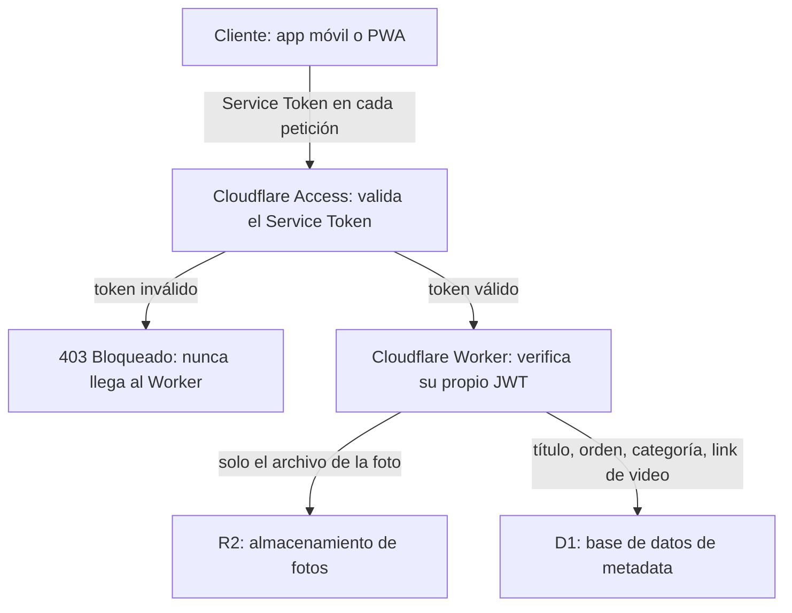
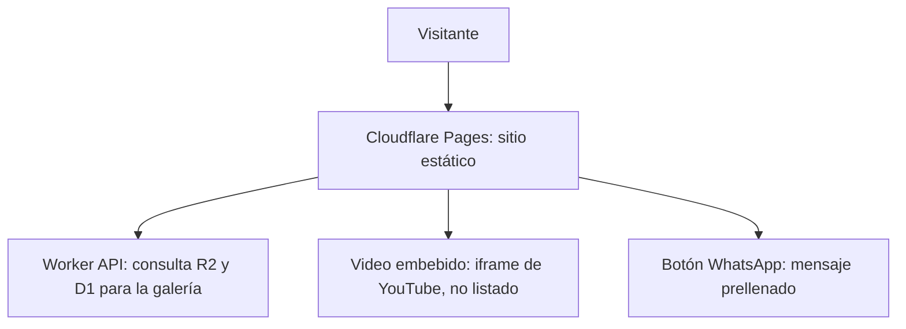

# 02 — Arquitectura y Despliegue

## 1. Patrón general: Jamstack + API mínima

El sitio público es **estático** (generado en build time con Astro, servido por Cloudflare Pages). La única parte dinámica en tiempo de ejecución es la galería, que se resuelve mediante una llamada a un **Worker API** que consulta R2 (fotos) y D1 (metadata). No existe backend tradicional ni servidor que administrar.

Este patrón reemplaza la arquitectura considerada originalmente (VM propia + Cloudflare como proxy), descartada por innecesaria para este alcance (ver `00`, sección 5).

## 2. Flujo A — Actualización de contenido (el cliente sube una obra)

### 2.1 Capas de autenticación (defensa en profundidad)

La autenticación ocurre en dos capas independientes, no una sola:

1. **Cloudflare Access (Service Token):** antes de que cualquier petición hacia las rutas de escritura de la API llegue al Worker, Cloudflare la intercepta en su propio borde de red y exige dos headers (`CF-Access-Client-Id` y `CF-Access-Client-Secret`), generados una sola vez desde el dashboard de Cloudflare. Si faltan o son inválidos, Cloudflare responde con un 403 directo — el Worker nunca se ejecuta, ni D1 ni R2 son tocados.
2. **JWT propio del Worker:** una vez que la petición pasa la capa de Access, el Worker hace su propia verificación de un JWT de vida corta, emitido tras el login del usuario administrador.

**Por qué dos capas y no una:** la capa de Access detiene la gran mayoría de ataques automatizados/oportunistas (bots escaneando internet) sin que ni siquiera lleguen a ejecutar código propio. El JWT del Worker es la segunda línea de defensa específica de este proyecto. Ninguna de las dos capas es infalible por sí sola contra un atacante que se proponga específicamente analizar la app cliente y extraer sus credenciales — pero juntas elevan significativamente el costo de un ataque, que es el objetivo realista para este proyecto.

### Responsabilidades de cada componente

- **App móvil o PWA:** interfaz de subida para el cliente. No tiene acceso directo a R2 ni D1 — todo pasa por el Worker. Envía las credenciales de Service Token (Access) en cada petición como headers, además del JWT de sesión. Decisión pendiente de confirmar: app nativa (con costo de tienda) vs. PWA (gratis, recomendada por defecto salvo necesidad específica de notificaciones push nativas).
- **Cloudflare Access (Service Tokens):** capa de seguridad perimetral. Intercepta el tráfico en el borde de la red antes de llegar a la lógica de la aplicación. Si no se presentan el `Client ID` y `Client Secret` correctos, bloquea la petición (403), eliminando el 99% del ruido de bots y escáneres automatizados.
- **Cloudflare Worker:** punto de entrada a la lógica, protegido por Access. Responsabilidades:
  - Verificar token de sesión (JWT de vida corta, emitido una vez y renovado — un solo usuario, no requiere proveedor de identidad completo tipo Auth0/Firebase).
  - Generar URL de subida firmada y temporal hacia R2 (patrón *pre-signed upload URL* — la app sube el archivo directo a R2 con esa URL, sin que la app tenga jamás una credencial permanente).
  - Validar y escribir la metadata en D1.
  - Aplicar rate limiting (nativo de Cloudflare Workers) para mitigar abuso si el endpoint fuera descubierto.
- **R2:** almacena únicamente los archivos binarios de las fotos. Nunca metadata, nunca links de video.
- **D1:** almacena todo el texto/dato: título, descripción, categoría, orden de visualización, y el link de YouTube del video asociado (si aplica). Ver esquema completo en `03`.

### Nota sobre el video

El video **no pasa por este flujo**. El cliente lo sube directamente a YouTube (modalidad "no listado") desde su propio celular, y pega el link resultante en el mismo formulario de la app — ese link se guarda como un campo de texto en D1, igual que el título. No es hardcoding: es un dato editable, igual que cualquier otro campo.

### 2.2 Mecanismo de la ruta privada de administración

La ruta privada de administración es servida por Cloudflare Pages como una página más del mismo proyecto (no un proyecto ni un despliegue separado). Esa página se entrega completa una sola vez; el propio código de la página (JavaScript ejecutado en el cliente) decide, según si existe o no un JWT válido almacenado, si mostrar la pantalla de login o la interfaz de gestión de contenido — no hay una redirección del servidor hacia "otra página" para cada estado.

El Worker nunca sirve HTML ni ninguna interfaz visual, bajo ninguna circunstancia — únicamente responde datos en formato JSON. Cualquier implementación que haga que el Worker devuelva HTML de administración se considera un desvío de esta especificación.

## 3. Flujo B — Visita pública

- **Cloudflare Pages** sirve el HTML/CSS/JS generado por Astro en build time — hero, lista de precios, testimonios, estructura general.
- La sección de **galería** hace una llamada del lado del cliente (fetch en el navegador del visitante) al mismo Worker API (en modo lectura, sin autenticación, solo lectura pública de datos ya publicados) para obtener la lista de obras y sus URLs de imagen en R2.
- Los **videos** se embeben directamente desde YouTube usando el link guardado en D1 — ningún procesamiento adicional necesario.
- El **botón de WhatsApp** es un link estático `wa.me` con el mensaje de cotización prellenado (ver `01`, sección 4) — no requiere ningún componente de infraestructura.

## 4. Principios de seguridad aplicados (DevSecOps)

1. **Ningún panel de administración navegable de forma pública.** La ruta de administración no está enlazada desde ningún punto del sitio público. El Worker nunca sirve HTML — solo responde JSON a quien presente credenciales válidas en ambas capas de autenticación (ver sección 2.1).
2. **Defensa en profundidad (Defense in Depth).** Se utiliza Cloudflare Access (Service Tokens) en el borde de red como primera barrera para descartar tráfico automatizado y escáneres, requiriendo credenciales válidas antes de ejecutar la aplicación. Como segunda barrera independiente, el Worker valida el JWT de sesión del usuario.
3. **Principio de mínimo privilegio en las credenciales.** La app cliente nunca posee una clave permanente de R2 o D1. Las URLs de subida son firmadas, de un solo uso, y expiran en minutos.
4. **Autenticación proporcional al riesgo real.** Al ser un solo usuario administrador, se usa un JWT simple de vida corta en vez de un proveedor de identidad completo (evita complejidad innecesaria sin sacrificar seguridad real para este caso).
5. **Rate limiting en el Worker**, para que un endpoint eventualmente descubierto no sea trivialmente abusable por fuerza bruta.
6. **Todo el tráfico sobre HTTPS** (por defecto en Cloudflare, no requiere configuración adicional).
7. **Defensa en profundidad mediante capas independientes.** La seguridad no depende de un único mecanismo (ni de ocultar rutas, ni de un solo token) — combina una capa de borde de red (Cloudflare Access) con una capa de aplicación (JWT propio del Worker), de modo que comprometer una sola capa no sea suficiente para acceder a los datos.

## 5. Costos de infraestructura (confirmado con fuentes, ver `00` para correcciones sobre supuestos previos)

| Componente | Costo |
|---|---|
| Cloudflare Pages | $0 |
| Cloudflare Workers | $0 (100k solicitudes/día en tier gratuito) |
| Cloudflare Access | $0 (gratis hasta 50 usuarios) |
| Cloudflare D1 | $0 (5GB almacenamiento, 5M lecturas/escrituras al mes en tier gratuito) |
| Cloudflare R2 | $0 (10GB almacenamiento, 1M operaciones/mes en tier gratuito, sin cargo de egress) |
| YouTube (video no listado) | $0 |
| GitHub (repositorio) | $0 |
| App nativa (si se elige en vez de PWA) | Apple Developer: $99/año · Google Play: $25 único pago |

## 6. Decisión pendiente de confirmar antes de implementación

**App nativa vs. PWA** para la interfaz de subida del cliente — impacta directamente el costo (ver tabla arriba) y el esfuerzo de desarrollo. Recomendación de este documento: **PWA por defecto**, salvo que se identifique una necesidad específica de notificaciones push nativas robustas que la justifique.
