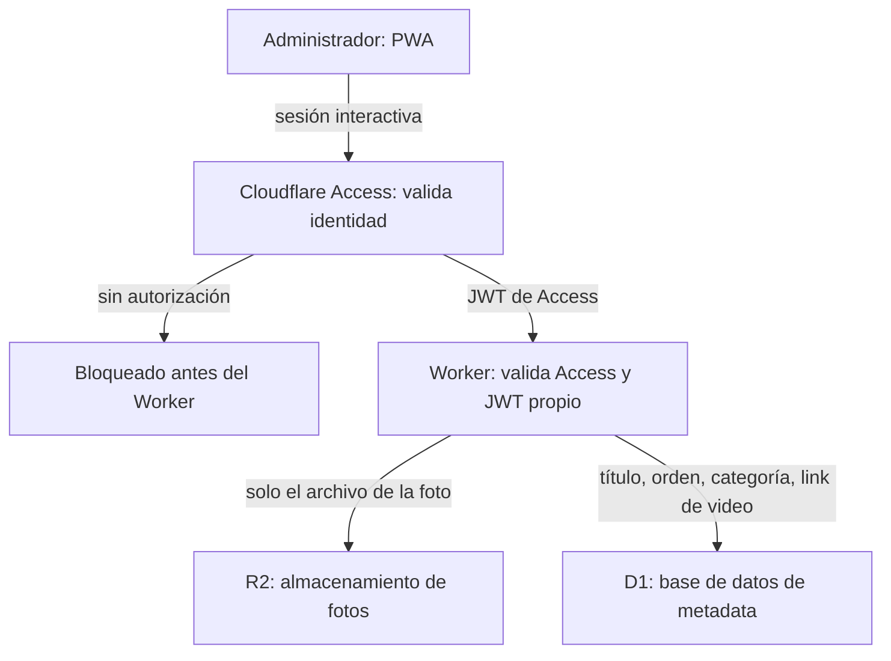
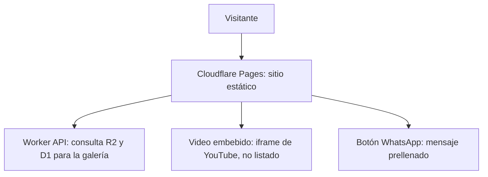

# 02 — Arquitectura y Despliegue

> **Actualización de implementación (11-10-2026):** la propuesta original de Service Tokens en la PWA fue sustituida por una sesión interactiva de Cloudflare Access. Un secreto de Service Token no debe aparecer en el JavaScript público. El Worker valida el JWT de Access (firma, emisor y audiencia) antes del login y de toda operación privada; el JWT propio sigue siendo la segunda capa. Esta integración aún requiere ensayo aislado con la política real de Access y cookies/CORS. Véase `12-procedimiento-promocion-production.md`.

## 1. Patrón general: Jamstack + API mínima

El sitio público es **estático** (generado en build time con Astro, servido por Cloudflare Pages). La única parte dinámica en tiempo de ejecución es la galería, que se resuelve mediante una llamada a un **Worker API** que consulta R2 (fotos) y D1 (metadata). No existe backend tradicional ni servidor que administrar.

Este patrón reemplaza la arquitectura considerada originalmente (VM propia + Cloudflare como proxy), descartada por innecesaria para este alcance (ver `00`, sección 5).

## 2. Flujo A — Actualización de contenido (el cliente sube una obra)

### 2.1 Capas de autenticación (defensa en profundidad)

La autenticación ocurre en dos capas independientes, no una sola:

1. **Cloudflare Access (sesión interactiva):** debe proteger `/admin/*` y las rutas privadas de la API con una identidad autorizada. El Worker verifica el JWT `Cf-Access-Jwt-Assertion` y su audiencia; si falta o es inválido responde 403. Una prueba anónima confirma la redirección de Pages a Access; falta validar la política real de la API y una sesión autorizada.
2. **JWT propio del Worker:** una vez que la petición pasa la capa de Access, el Worker hace su propia verificación de un JWT de vida corta, emitido tras el login del usuario administrador.

**Por qué dos capas:** Access valida la identidad admitida por la política de Cloudflare y el JWT propio autoriza la sesión de edición. El código no presupone que la configuración de borde sea perfecta; verifica Access también en el Worker.

### Responsabilidades de cada componente

- **PWA administrativa:** interfaz de subida sin acceso directo a R2 ni D1. Usa la sesión de Access del navegador y el JWT propio del Worker; nunca contiene un Client Secret persistente.
- **Cloudflare Access:** capa de identidad en el borde para la administración. La configuración de Pages y API debe comprobarse antes de producción.
- **Cloudflare Worker:** punto de entrada a la lógica, protegido por Access. Responsabilidades:
  - Verificar token de sesión (JWT de vida corta, emitido una vez y renovado — un solo usuario, no requiere proveedor de identidad completo tipo Auth0/Firebase).
  - Generar URL de subida firmada y temporal hacia R2 (patrón *pre-signed upload URL* — la app sube el archivo directo a R2 con esa URL, sin que la app tenga jamás una credencial permanente).
  - Validar y escribir la metadata en D1.
  - Aplicar rate limiting (nativo de Cloudflare Workers) para mitigar abuso si el endpoint fuera descubierto.
- **R2:** almacena únicamente los archivos binarios de las fotos. Nunca metadata, nunca links de video.
- **D1:** almacena todo el texto/dato: título, descripción, categoría, orden de visualización, y el link de YouTube del video asociado (si aplica). Ver esquema completo en `03`.

### Nota sobre el video

El video **no pasa por este flujo**. El cliente lo sube directamente a YouTube (modalidad "no listado") desde su propio celular, y pega el link resultante en el mismo formulario de la app — ese link se guarda como un campo de texto en D1, igual que el título. No es hardcoding: es un dato editable, igual que cualquier otro campo.

### 2.2 Mecanismo de la ruta privada de administración

La administración consta de rutas estáticas de Cloudflare Pages (`/admin/*`). Access debe impedir su entrega a visitantes no autorizados; dentro de la sesión admitida, el JavaScript comprueba el JWT propio y dirige entre login y páginas de gestión. La redirección client-side por sí sola no constituye protección de la página.

El Worker nunca sirve HTML ni ninguna interfaz visual, bajo ninguna circunstancia — únicamente responde datos en formato JSON. Cualquier implementación que haga que el Worker devuelva HTML de administración se considera un desvío de esta especificación.

## 3. Flujo B — Visita pública

- **Cloudflare Pages** sirve el HTML/CSS/JS generado por Astro en build time — hero, lista de precios, testimonios, estructura general.
- La sección de **galería** hace una llamada del lado del cliente (fetch en el navegador del visitante) al mismo Worker API (en modo lectura, sin autenticación, solo lectura pública de datos ya publicados) para obtener la lista de obras y sus URLs de imagen en R2.
- Los **videos** se embeben directamente desde YouTube usando el link guardado en D1 — ningún procesamiento adicional necesario.
- El **botón de WhatsApp** es un link estático `wa.me` con el mensaje de cotización prellenado (ver `01`, sección 4) — no requiere ningún componente de infraestructura.

## 4. Principios de seguridad aplicados (DevSecOps)

1. **Panel privado.** Access debe proteger las rutas `/admin/*`; el Worker no sirve HTML y exige Access más JWT propio para escrituras. No enlazar el panel desde el sitio público no sustituye ese control.
2. **Defensa en profundidad.** Access valida la identidad interactiva y el Worker comprueba su JWT; el JWT de sesión de la aplicación es una barrera independiente.
3. **Principio de mínimo privilegio en las credenciales.** La app cliente nunca posee una clave permanente de R2 o D1. Las URLs de subida son firmadas, de un solo uso, y expiran en minutos.
4. **Autenticación proporcional al riesgo real.** Al ser un solo usuario administrador, se usa un JWT simple de vida corta en vez de un proveedor de identidad completo (evita complejidad innecesaria sin sacrificar seguridad real para este caso).
5. **Rate limiting en el Worker**, para que un endpoint eventualmente descubierto no sea trivialmente abusable por fuerza bruta.
6. **Todo el tráfico sobre HTTPS** (por defecto en Cloudflare, no requiere configuración adicional).
7. **Capas independientes.** La seguridad combina identidad en Cloudflare Access, verificación del JWT de Access dentro del Worker y el JWT propio de sesión.

## 5. Costos de infraestructura (confirmado con fuentes, ver `00` para correcciones sobre supuestos previos)

| Componente | Costo |
|---|---|
| Cloudflare Pages | $0 |
| Cloudflare Workers | $0 (100k solicitudes/día en tier gratuito) |
| Cloudflare Access | $0 (gratis hasta 50 usuarios) |
| Cloudflare D1 | $0 (5GB almacenamiento, 5M lecturas/escrituras al mes en tier gratuito) |
| Cloudflare R2 | $0 (10GB almacenamiento, 1M operaciones/mes en tier gratuito, sin cargo de egress) |
| YouTube (video no listado) | $0 |
| GitHub (repositorio) | $0 |
| App nativa (si se elige en vez de PWA) | Apple Developer: $99/año · Google Play: $25 único pago |

## 6. Decisión pendiente de confirmar antes de implementación

**App nativa vs. PWA** para la interfaz de subida del cliente — impacta directamente el costo (ver tabla arriba) y el esfuerzo de desarrollo. Recomendación de este documento: **PWA por defecto**, salvo que se identifique una necesidad específica de notificaciones push nativas robustas que la justifique.
